# bushgen

Procedural pixel art bushes, plants and hedge blocks for LÖVE games.
Pure Lua generator (no LÖVE needed to generate), plus a small helper for
LÖVE and a viewer to browse styles.

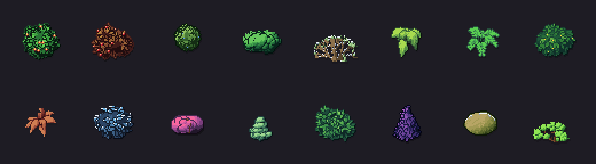

- 19 kinds: round bushes, leaf balls, mounds of leaf heads, hedges, ferns,
  grass, big leaves, tiered bushes, branchy brambles, bare winter twigs,
  topiary shapes and the cube
- the cube: a trimmed hedge of cubic volume, for tile maps too: `square`
  view (orthogonal, Factorio style) and `iso` (2:1 pixel isometric),
  seamless when neighbours are joined
- winter: snow on any kind
- one call to ask for any of them, with the sprite size you need
- styles: one random style gives a whole set of plants that belong together
  (palette, outline, texture, flowers)
- deterministic: the same seed always gives the same sprite
- smooth mutation: every parameter changes smoothly with time `t`, so plants
  can be animated or tweaked in small steps

## Files

Copy these into your game:

| file | what it is |
|---|---|
| `bushgen.lua` | the generator: recipe in, pixels out (pure Lua) |
| `variety.lua` | makes recipes: styles, plants, cubes; `request` |
| `data_plants.lua` | base presets of all kinds, including `cube` |
| `data_variety.lua` | random ranges for styles and plants |
| `bushlove.lua` | optional: turns results into LÖVE images |

Viewer only (not needed in a game): `main.lua`, `conf.lua`, `data_maze.lua`.
README pictures: `images/`. Every picture here was rendered with exactly the
call shown next to it.

## Words used here

- **style**: the shared look of a set: palette, outline, shadow, texture,
  leaf grain, flowers, bark colour. Made from a style seed.
- **plant / block**: one sprite in a style. Made from its own seed.
- **seed**: any integer. Same seed, same result.
- **t**: time. Default 0. Small changes of `t` give small changes of the
  sprite (see Animation). Use 0 if you do not animate.
- **anchor** (`ax`, `ay`): the pixel of the sprite that belongs on your map
  position. Draw the sprite at `x - ax, y - ay`.
  - plants: the centre of the plant
  - square blocks: the centre of the map cell (the block fills the cell)
  - iso blocks: the centre of the cell diamond, on the ground
- **design box**: plants are built inside a 32 x 32 box, but the sprite is
  48 x 48 so leaf tips, outline and shadow are never cut. Sprites overlap
  their neighbours when drawn on a 32 px grid; that is intended.

## Quick start (LÖVE)

```lua
local bushlove = require("bushlove")

local bush

function love.load()
    love.graphics.setDefaultFilter("nearest", "nearest")
    -- style seed 7, plant seed 1, random kind
    bush = bushlove.plant(7, 1)
end

function love.draw()
    local scale = 4
    love.graphics.draw(bush.image, 200 - bush.ax * scale, 200 - bush.ay * scale, 0, scale, scale)
end
```

`bushlove.plant` and `bushlove.block` return a sprite table:
`{image, data, w, h, ax, ay}` (`data` is the ImageData, keep it if you want
to save the sprite with `data:encode("png", name)`).

## One call for everything: request

```lua
local bushlove = require("bushlove")

-- random kind, 48 px sprite
local a = bushlove.request({style = 7, seed = 1})

-- a specific kind in a larger sprite
local b = bushlove.request({style = 7, seed = 2, kind = "leafball", size = 64})

-- a cube (trimmed hedge) for a 32 px square map cell, joined to the east
local c = bushlove.request({style = 7, seed = 3, kind = "cube", size = 48,
    view = "square", height = 12, join = {e = true}})
```

Without LÖVE: `variety.request(o)` returns the pixel result (see Without
LÖVE) and the recipe.

Fields of the request, all optional:

| field | default | meaning |
|---|---|---|
| `style` | 1 | style seed (follows `t`) or a table from `variety.makeStyle` |
| `seed` | 1 | plant seed |
| `t` | 0 | time, for animation |
| `kind` | random | a name from `data_plants.lua`, list below |
| `size` | 48 | sprite size in pixels (square sprite) |
| `box` | 2/3 of `size` | plants: the area the plant is built in |
| `view` | `"square"` | cube only: `"square"` or `"iso"` |
| `tile` | `size - 2 * margin` | cube only: cell width on screen |
| `margin` | `size / 6` | cube only: free pixels around the cell |
| `height`, `depth`, `join`, `sharp`, `round`, `cover` | | cube only, see Cubes |

**Styles.** The style decides the colours, outline, texture, leaf grain,
flowers and snow; the seed decides the shape. One plant, eight styles:

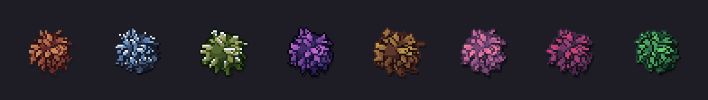

```lua
for k, style in ipairs({2, 7, 19, 24, 27, 31, 36, 44}) do
    sprites[k] = bushlove.request({style = style, seed = 5, kind = "leafball"})
end
```

**Sprite size.** Plants are built in a box of 2/3 of the sprite, the rest
is room for leaf tips, outline and shadow. A larger size gives a larger
plant with more detail: leaves and clumps keep their pixel size, so a 96 px
bush simply has more of them. Sizes from 32 to 96 work; typical are 48
(plants on a 32 px grid) and 64.

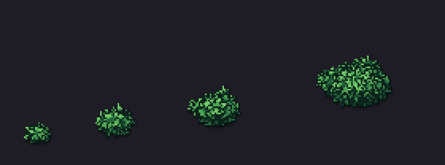

```lua
for k, size in ipairs({32, 48, 64, 96}) do
    sprites[k] = bushlove.request({style = 23, seed = 4, kind = "leafball", size = size})
end
```

A cube in the `square` view is `size x size` (`tile = size - 2 * margin`,
so 32 for 48); in the `iso` view it is `size` wide and as high as its
diamond plus `height`.

## Kinds

Every kind below is shown with seeds 1 to 6 in one style, made with this
loop (only `style`, `kind` and sometimes `size` change):

```lua
local bushlove = require("bushlove")
local sprites = {}

for seed = 1, 6 do
    sprites[seed] = bushlove.request({style = 23, seed = seed, kind = "round"})
end
```

How a kind is built is told in one or two sentences; the numbers behind it
are in `data_plants.lua`. All kinds share the same finish: the light is
rounded to the colours of the palette, parts that are overlapped by closer
parts get a dark seam, then outline and drop shadow.

### round

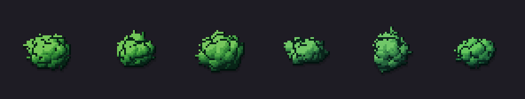

A core sphere covered by 14 to 20 round clumps. Every clump is lit partly
as itself and partly as the whole bush, so the bush keeps one clear form.

```lua
bushlove.request({style = 23, seed = seed, kind = "round"})
```

### foliage

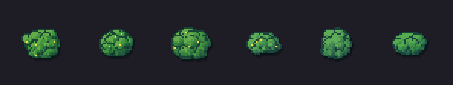

Like `round` with fewer, larger clumps; light pixels hang down into the
shade below (fringe) and small leaf stamps add texture.

```lua
bushlove.request({style = 3, seed = seed, kind = "foliage"})
```

### sphere

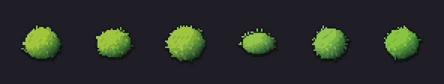

One big ball with a few soft bumps; the foliage look comes only from texture
stamps, fringe and leaf tips on the outline. In a style without texture it
becomes a clean trimmed ball.

```lua
bushlove.request({style = 28, seed = seed, kind = "sphere"})
```

### hedge

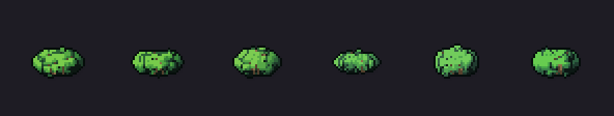

A wide low body: five cores along a line, clumps over it, and forked
branches that show through the darkest spots.

```lua
bushlove.request({style = 47, seed = seed, kind = "hedge"})
```

### fine

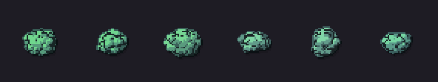

Like `round`, but built from 45 to 60 small clumps: a dense, fine surface.

```lua
bushlove.request({style = 43, seed = seed, kind = "fine"})
```

### cluster

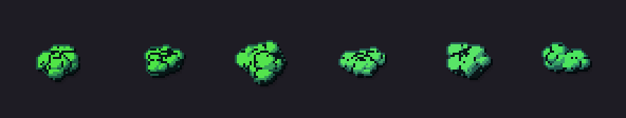

Two to four separate round bushes growing into each other; the lower ones
are closer and overlap the others.

```lua
bushlove.request({style = 21, seed = seed, kind = "cluster"})
```

### leafy

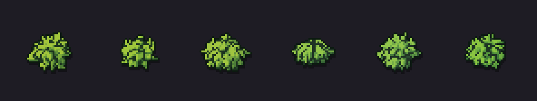

A dark core covered by 40 to 50 small curved leaves pointing away from the
centre.

```lua
bushlove.request({style = 28, seed = seed, kind = "leafy"})
```

### spiky

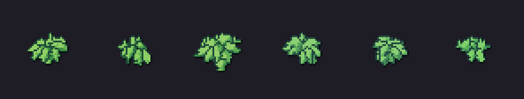

A rosette: 7 to 10 long leaves around one point, spread by the golden angle,
inner leaves shorter and more upright, each leaf folded along its midrib.

```lua
bushlove.request({style = 46, seed = seed, kind = "spiky"})
```

### fern

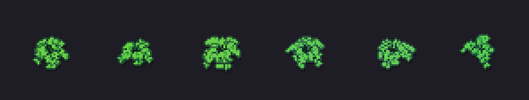

Fronds: thin curved stems with pairs of small leaflets that get shorter
toward the tip.

```lua
bushlove.request({style = 18, seed = seed, kind = "fern"})
```

### broad

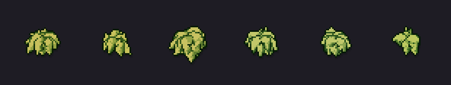

A rosette of wide leaves that droop at the tips.

```lua
bushlove.request({style = 37, seed = seed, kind = "broad"})
```

### grass

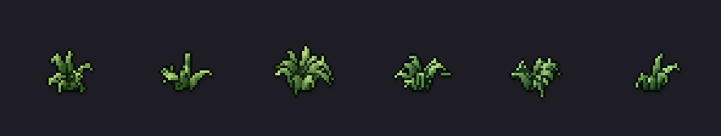

A tuft of blades rising from one base and bending out.

```lua
bushlove.request({style = 10, seed = seed, kind = "grass"})
```

### tiered

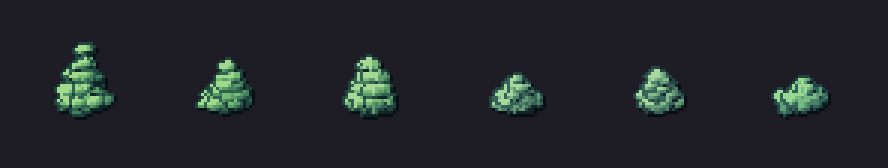

Flat round layers stacked up and narrowing to the top, each layer casting
a dark band on the one below.

```lua
bushlove.request({style = 42, seed = seed, kind = "tiered"})
```

### bramble

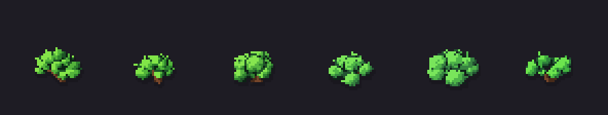

Branches that fork twice; leaf clumps sit on the tips and on some joints,
the branches stay visible between them.

```lua
bushlove.request({style = 5, seed = seed, kind = "bramble"})
```

### bigleaf

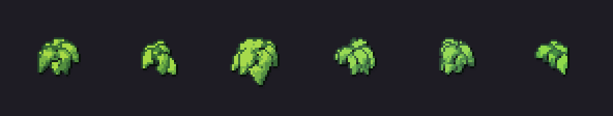

A few broad leaves around the centre, each with a glossy spot on its lit
half.

```lua
bushlove.request({style = 30, seed = seed, kind = "bigleaf"})
```

### leafball

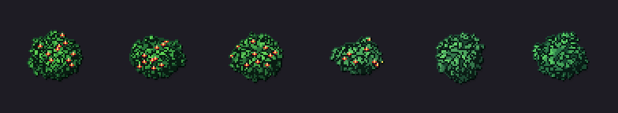

A dark inner ball (the shade inside the bush) covered by a carpet of
separate leaves, 3 to 5 pixels each. Every leaf grows out of the surface,
outward and a little down, with a lighter tip; at the silhouette the leaves
stand out and make a leafy outline. Berries or flowers come from the style.

```lua
bushlove.request({style = 44, seed = seed, kind = "leafball", size = 64})
```

### clumps

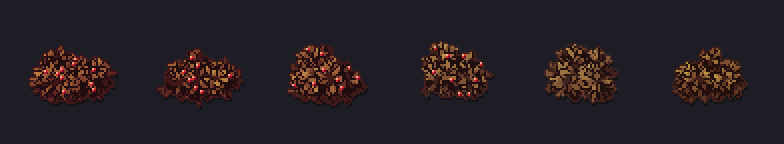

A mound of round leaf heads: a lower row of larger heads in front, a few
smaller heads behind, each head lit as a ball of its own, with a dark seam
where heads meet and branches in the gaps. Reads best from 64 pixels up.

```lua
bushlove.request({style = 27, seed = seed, kind = "clumps", size = 64})
```

### twigs

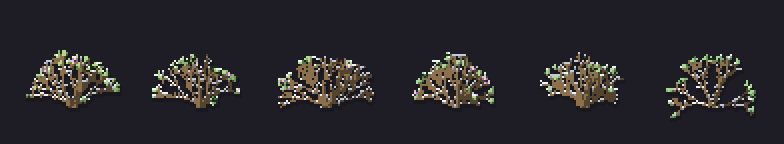

A bare winter bush: thin branches fan out from the base and fork three
times into a dome; some tips keep a small bunch of leftover leaves. Style 6 is a
snowy style, so the branches carry snow.

```lua
bushlove.request({style = 6, seed = seed, kind = "twigs", size = 64})
```

### topiary

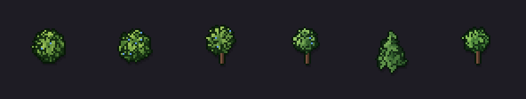

Trimmed garden shapes: ball, cone, cylinder and lollipop (a ball on a
stem). The shape is a 3D distance field, traced per pixel by a camera tipped
down by about 29 degrees, and covered by a fine leaf carpet. The seed picks
the form, or ask for one with `form`:

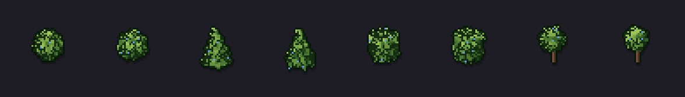

```lua
bushlove.request({style = 40, seed = seed, kind = "topiary"})
bushlove.request({style = 40, seed = 1, kind = "topiary", form = "cone"})
```

### cube

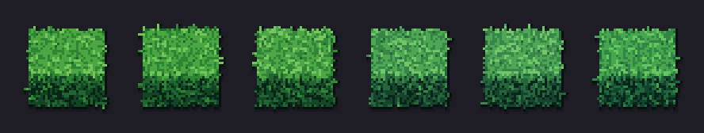

A trimmed hedge of cubic volume: a box with slightly rounded edges, drawn
dark, covered by an even carpet of small leaves; each face keeps one clear
tone. See Cubes below for tile maps.

```lua
bushlove.request({style = 23, seed = seed, kind = "cube"})
```

## Winter

Any kind can carry snow: caps on every edge that is open to the sky, in
short dashes, bright on lit parts and bluish grey in the shade. A style may
be snowy by itself (`snowChance` in `data_variety.lua`); `snow` in the
request sets the amount from 0 to 1.

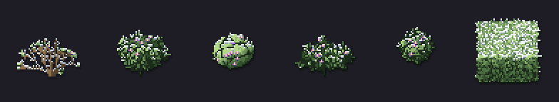

```lua
for k, kind in ipairs({"twigs", "leafball", "round", "clumps", "topiary", "cube"}) do
    sprites[k] = bushlove.request({style = 6, seed = 2, kind = kind, size = 64, snow = 0.7})
end
```

## Requesting plants on demand

```lua
local variety = require("variety")
local bushlove = require("bushlove")

-- one style for the whole level, so all plants match
local style = variety.makeStyle(levelNumber * 31 + 5)

-- random kind, decided by the seed
local a = bushlove.plant(style, 1001)

-- a specific kind
local b = bushlove.plant(style, 1002, 0, "hedge")
local c = bushlove.plant(style, 1003, 0, "bigleaf")
```

Kinds (names from `data_plants.lua`, all shown above):
`round`, `foliage`, `sphere`, `hedge`, `fine`, `cluster`, `leafy`,
`spiky`, `fern`, `broad`, `grass`, `tiered`, `bramble`, `bigleaf`,
`leafball`, `clumps`, `twigs`, `topiary` and `cube`.
An unknown name raises an error.

The random kind is picked with the weights in `data_variety.lua`
(`plant.kinds`). Set a weight to 0 to never get that kind by chance.

### Seeds from map positions

To get a different but stable plant on every cell, make the seed from the
position:

```lua
local seed = level * 1000003 + y * 1009 + x
```

Any integers work; just keep them unique per sprite you want to differ.

## Cubes (hedge blocks) for tile maps

The cube is a bush of cubic volume. Ask for it with `request` and
`kind = "cube"`, or with `bushlove.block` / `variety.makeBlock` when you
want to set `tile` directly; both make the same thing.

A cube is a trimmed hedge that fills exactly one map cell: a box with
slightly rounded edges, covered by an even carpet of small leaves. Each face
keeps one clear tone (top light, the side toward the light mid, the other
side dark), the leaves add a fine texture and the dark inside shows between
them. Ask for it with an options table:

```lua
local sprite = bushlove.block(style, seed, t, {
    shape = "square",   -- "square" or "iso"
    tile = 32,          -- cell width on screen, pixels
    height = 12,        -- square: front face height; iso: how high it rises
    join = {n = true, e = false, s = true, w = false}, -- neighbour blocks
    sharp = 0.7,        -- 0 wild .. 1 neatly trimmed (default 0.7)
})
```

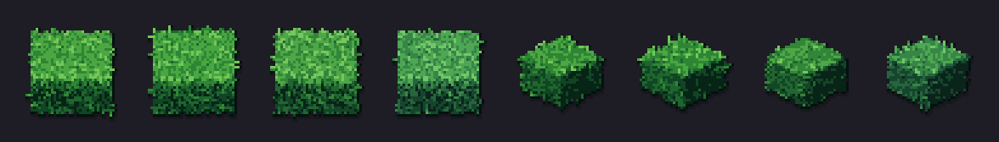

```lua
for seed = 1, 4 do
    square[seed] = bushlove.request({style = 23, seed = seed, kind = "cube", view = "square", height = 12})
    iso[seed] = bushlove.request({style = 23, seed = seed, kind = "cube", view = "iso", height = 12})
end
```

Other options, all optional: `depth` (square only: top face height on
screen, default `tile - height`), `margin` (free pixels around the cell,
default 8), `round` (radius of the rounded edges in pixels, default about 1),
`cover` (how densely the leaves cover the surface). Leaf size follows the
grain of the style.

Map directions are the same for both shapes: `e` is the next column
(x + 1), `w` the previous column, `s` the next row (y + 1), `n` the
previous row. Pass `join` from your map so connected walls look like one
hedge: the hedge grows across that edge and draws no outline there.

```lua
local function isWall(map, x, y)
    local row = map[y]
    return row ~= nil and row:sub(x, x) == "#"
end

local function joinOf(map, x, y)
    return {
        n = isWall(map, x, y - 1), e = isWall(map, x + 1, y),
        s = isWall(map, x, y + 1), w = isWall(map, x - 1, y),
    }
end
```

The sprite size depends only on `shape`, `tile`, `depth`, `height` and
`margin`, so it stays the same during animation. You can ask for it
without generating: `bushgen.size(recipe)` returns `w, h, ax, ay`.

### Square: orthogonal 2.5D, Factorio style

The block fills exactly one map cell on screen: its top face is
`tile - height` pixels high, its front face `height` pixels, together one
tile. So a 32 px tile with `height = 12` has a 20 px top and a 12 px front,
and nothing reaches into the cell above (only a few leaf tips and the
outline, which the margin holds).

The anchor is the centre of the cell. Cell centre on screen for map cell
`(x, y)` (1-based):

```
sx = ox + (x - 1) * tile + tile / 2
sy = oy + (y - 1) * tile + tile / 2
```

Like in Factorio this is not a true 3D projection: between two walls one
above the other there would be a gap of `height` in the world. With
`join.s = true` the block bridges it, its front face disappears behind the
neighbour below and a vertical wall reads as one long top. So always pass
`join` for walls.

If you set `depth` yourself, the block is `depth + height` pixels high and
the anchor stays in its middle.

Draw row by row from top to bottom, so lower walls cover the front faces
of the walls behind them:

```lua
local map = {
    "#######",
    "#..#..#",
    "#.##..#",
    "#.....#",
    "#######",
}

local TILE, HEIGHT = 32, 12
local walls = {}

function buildMaze(style)
    for y = 1, #map do
        for x = 1, #map[y] do
            if isWall(map, x, y) then
                walls[#walls + 1] = {
                    x = (x - 1) * TILE + TILE / 2,
                    y = (y - 1) * TILE + TILE / 2,
                    sprite = bushlove.block(style, y * 1009 + x, 0,
                        {shape = "square", tile = TILE, height = HEIGHT, join = joinOf(map, x, y)}),
                }
            end
        end
    end
end

function drawMaze(ox, oy)
    -- walls were added row by row, which is already back to front
    for _, w in ipairs(walls) do
        love.graphics.draw(w.sprite.image, ox + w.x - w.sprite.ax, oy + w.y - w.sprite.ay)
    end
end
```

Characters and other objects go into the same back to front order: sort
everything by the ground `y` of its anchor.

### Iso: 2:1 pixel isometric

The cell is a diamond `tile` wide and `tile / 2` high. The hedge shows its
top diamond and the two front faces (left face lit, right face in shade).

Cell centre on screen for map cell `(x, y)` (1-based):

```
sx = ox + (x - y) * tile / 2
sy = oy + (x + y - 2) * tile / 4
```

Draw in order of `x + y` (back to front):

```lua
local isoWalls = {}

local function isoOrder(a, b)
    if a.d ~= b.d then return a.d < b.d end
    return a.y < b.y
end

function buildIsoMaze(style)
    for y = 1, #map do
        for x = 1, #map[y] do
            if isWall(map, x, y) then
                isoWalls[#isoWalls + 1] = {
                    d = x + y, y = y,
                    sx = (x - y) * TILE / 2,
                    sy = (x + y - 2) * TILE / 4,
                    sprite = bushlove.block(style, y * 1009 + x, 0,
                        {shape = "iso", tile = TILE, height = 12, join = joinOf(map, x, y)}),
                }
            end
        end
    end
    table.sort(isoWalls, isoOrder)
end

function drawIsoMaze(ox, oy)
    for _, w in ipairs(isoWalls) do
        love.graphics.draw(w.sprite.image, ox + w.sx - w.sprite.ax, oy + w.sy - w.sprite.ay)
    end
end
```

Tip: in iso, high hedges hide the paths behind them. For mazes the player
must read, keep `height` around `tile / 3` or lower.

The map from above in both views (the floor colour is only the background of
the picture):

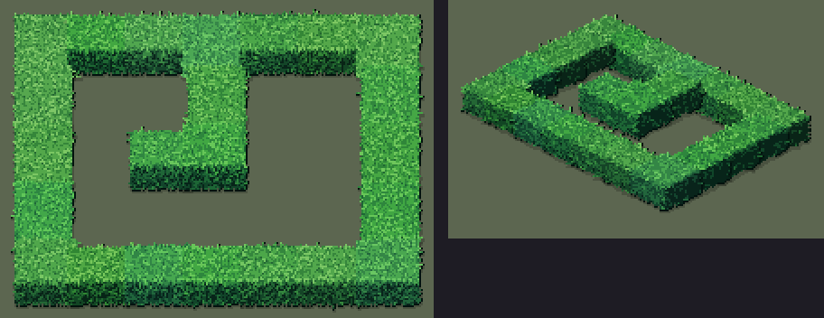

```lua
local variety = require("variety")
buildMaze(variety.makeStyle(23))
buildIsoMaze(variety.makeStyle(23))
```

### Free-standing plants on a tile map

Plants are not cell shaped; place their anchor where the plant should stand
(for example the cell centre) and draw them in the same back to front order
as everything else.

## Without LÖVE (pure Lua)

```lua
local bushgen = require("bushgen")
local variety = require("variety")

local style = variety.makeStyle(7)
local recipe = variety.makePlant(style, 1001, 0, "round")
local img = bushgen.generate(recipe, 1001)      -- plant: 48 x 48, box 32

local blockRecipe = variety.makeBlock(style, 5, 0, {shape = "iso", tile = 32, height = 12})
local blk = bushgen.generate(blockRecipe, 5)    -- block: size from the options
```

The result is `{w, h, ax, ay, pixels}`. `pixels` is a flat array, 1-based,
row by row, 4 values per pixel (r, g, b, a), each 0..1. Pixel `(x, y)`
(0-based) starts at index `(y * w + x) * 4 + 1`.

For plants you can choose the sizes:
`bushgen.generate(recipe, seed, spriteW, spriteH, box)`. The plant is built
in a `box` x `box` area (default 32) centred in the sprite (default 48).
A bigger box makes bigger plants with more detail; keep the sprite about
1.5 times the box.

Use the same seed for `makePlant` / `makeBlock` and `generate`.

## Performance and caching

Rough cost in plain Lua 5.5 (LuaJIT inside LÖVE is usually several times
faster): a plant takes 2 to 5 ms, a 32 px block 10 to 15 ms. So:

- generate at level load, or spread the work over frames (a few sprites per
  frame), never every frame for many sprites
- cache by your key (style seed, seed, options); the same key always gives
  the same sprite
- for big maps, generate a handful of variants per style (for example 8
  wall blocks per join pattern) and reuse them, instead of one per cell
- to skip generation on later runs, save `sprite.data:encode("png", name)`
  and load the png next time

## Animation (smooth mutation)

Every continuous parameter of a style and a plant follows its own smooth
random curve over `t`. Regenerating with `t` moved by about 0.01 changes
only about 1% of the pixels, so a slow `t` gives a living, slowly changing
plant (wind, seasons, a magic garden). New parts grow in from zero instead
of popping in.

```lua
-- in love.update, for a few sprites only (each call costs a full generate)
t = t + dt * 0.3
bush = bushlove.plant(style, seed, t)  -- style as a seed number follows t too
```

If `style` is a table from `variety.makeStyle(seed, t0)`, it is frozen at
`t0`; pass the style seed number instead to let the style change with `t`.

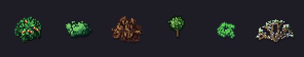

The picture runs `t` from 0 to 4 for six plants (one generate per plant and
frame).

Not animated (they cannot change smoothly): the plant kind, the outline
mode, the number of colours and the flower shape. They change only with a
different seed.

## Customising

- `data_variety.lua`: ranges of everything random. `style.hues` sets how
  often each colour family appears (greens, olive, teal, autumn, blue,
  purple); `plant.kinds` the weights of the kinds; `plant.scale` the size
  range.
- `data_plants.lua`: base values per kind. Field meanings are listed at the
  top of the file. You can also build a recipe by hand from a preset:

```lua
local bushgen = require("bushgen")
local plants = require("data_plants")
local img = bushgen.generate(plants[1], 42)    -- the "round" preset as it is
```

## Limitations

- In the square view a block has no side faces (pure 3/4 view). If your
  game shows walls from a slightly turned camera, it will not match.
- Joins are only between the four direct neighbours (n, e, s, w).
- Single pixels can flicker during animation when a shade crosses the border
  between two palette colours. That is how quantised pixel art behaves.
- Cubes use only the small leaf carpet (no grass blades or big leaves on
  cubes yet).
- The kinds do not share one camera: plants are seen from the front,
  topiary from 29 degrees above, square cubes in the Factorio projection.
  Next to each other this reads fine in pixel art, but it is not one exact
  perspective.
- `clumps` needs room: at 48 pixels the heads tend to merge, from 64 they
  read as separate heads.
- Snow lies on every edge open to the sky; on very fine foliage it can look
  grainy.

## Viewer

`love .` in this folder. Keys:

| key | action |
|---|---|
| space | play / pause |
| left / right | rewind / forward while held (shift: faster) |
| r | reverse playback |
| home | back to t = 0 |
| + / - | animation speed |
| up / down | select style |
| m | all plants in the selected style / back |
| b | maze demo (square and iso) / back |
| tab | presets of all kinds |
| n | new world (new seeds) |
| [ / ] | smaller / larger sprites (32, 48, 64, 96) |
| s / e | save all sprites as a png sheet / 5x larger |
| f | fit view |
| wheel, drag | zoom at mouse, move |
| h | help |

Saved files go to the LÖVE save directory (printed to the console).

## License

MIT, see `LICENSE`. Use it in free and commercial games, change it, ship it.
The sprites the generator makes are yours; no credit is required for them.
